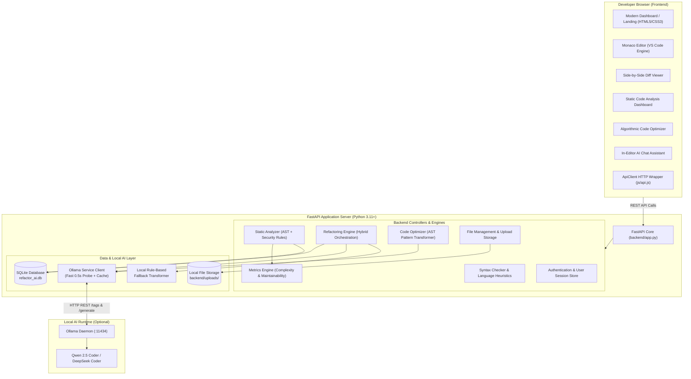
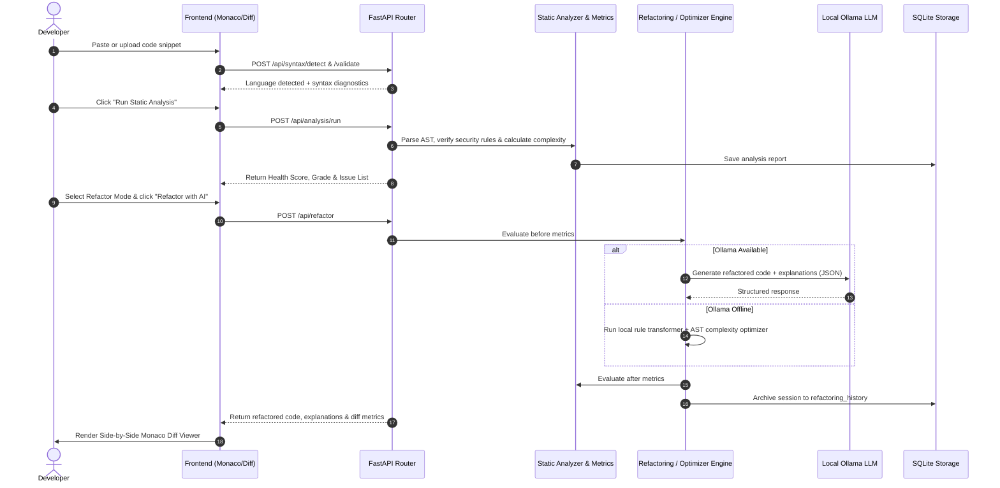

# ⚡ AI Code Refactoring Assistant

[](https://fastapi.tiangolo.com)
[](https://www.python.org/)
[](https://microsoft.github.io/monaco-editor/)
[](https://ollama.com/)
[](https://github.com/Saathwik-hub/Ai-code-refactoring-assistant)
[](https://opensource.org/licenses/MIT)
[](https://www.docker.com/)

A modern, full-stack developer workspace for source code validation, multi-language static code analysis, AST-based algorithmic optimization, and AI-powered refactoring with a side-by-side diff viewer.

---

## 📑 Table of Contents

- [Overview](#-overview)
- [Problem Statement & Motivation](#-problem-statement--motivation)
- [Key Features](#-key-features)
- [Application Screenshots](#-application-screenshots)
- [System Architecture](#-system-architecture)
- [End-to-End Workflow](#-end-to-end-workflow)
- [Technology Stack](#-technology-stack)
- [Repository Structure](#-repository-structure)
- [Prerequisites & Installation](#-prerequisites--installation)
- [Environment Configuration](#-environment-configuration)
- [Running Locally](#-running-locally)
- [Core Engines Deep-Dive](#-core-engines-deep-dive)
  - [Static Code Analysis Engine](#1-static-code-analysis-engine)
  - [Hybrid AI Refactoring Engine](#2-hybrid-ai-refactoring-engine)
  - [Algorithmic Code Optimizer Engine](#3-algorithmic-code-optimizer-engine)
  - [Ollama Local LLM Integration](#4-ollama-local-llm-integration)
- [API Documentation](#-api-documentation)
- [Automated Testing](#-automated-testing)
- [Docker & Containerization](#-docker--containerization)
- [Production Deployment](#-production-deployment)
- [Error Handling & Troubleshooting](#-error-handling--troubleshooting)
- [Current Limitations & Roadmap](#-current-limitations--roadmap)
- [Contributing](#-contributing)
- [License](#-license)

---

## 🌟 Overview

**AI Code Refactoring Assistant** provides a complete developer environment running locally in your browser. It pairs the industrial-grade **Monaco Editor** (the code editor powering Visual Studio Code) with a modular **FastAPI** backend that conducts static analysis, detects security vulnerabilities, calculates cyclomatic complexity, flattens inefficient algorithms, and connects to local open-source LLMs via **Ollama** — with a 100% offline rule-based fallback when no GPU or LLM server is present.

---

## 🎯 Problem Statement & Motivation

Writing clean, maintainable, and secure code is critical for software engineering teams, yet developers frequently encounter:
1. **Hidden Technical Debt & Security Risks**: Hardcoded secrets, unhandled exceptions, dynamic `eval()` execution, and excessive nesting depth often go undetected during rapid prototyping.
2. **Algorithmic Inefficiencies**: Nested loops performing linear list searches ($O(N^2)$) instead of hash set lookups ($O(N)$), redundant calculations, and unmemoized recursive functions degrade software throughput.
3. **Cloud Privacy Concerns**: Sending sensitive corporate or proprietary code to third-party proprietary cloud AI APIs violates organizational security policies.
4. **Fragmented Tooling**: Developers must jump between separate linters, web formatters, diff tools, and chat prompts to inspect and modernize snippets.

**AI Code Refactoring Assistant** resolves this by providing a unified, privacy-first local workbench that validates, inspects, optimizes, and refactors code entirely on your machine.

---

## ✨ Key Features

### 🖥️ Developer Workspace & Editor
- **Monaco Code Editor**: Full syntax highlighting, auto-indentation, line numbers, code folding, and autocomplete across Python, JavaScript, TypeScript, Java, C++, HTML, CSS, and JSON.
- **Theme Switching**: Dark theme (curated HSL developer palette: `#0d1117`, `#161b22`, `#3b82f6`) and Light theme with state persistence in `localStorage`.
- **Drag-and-Drop File Management**: Drag source files directly into the workspace with extension mapping, size validation (5 MB limit), and a sidebar tree explorer.

### 🔍 Multi-Language Static Code Analysis
- **Security Auditing**: Detects hardcoded secrets, unsafe `eval()` / `exec()` execution, `shell=True` subprocess calls, and insecure randomness (Bandit / OWASP rules).
- **Code Smells & Quality Checks**: Flags bare `except:` clauses, single-letter variables, oversized functions (>25 lines), and excessive line lengths.
- **Metrics & Grading**: Computes McCabe Cyclomatic Complexity, Nesting Depth, Readability, Maintainability Index, and Overall Health Score (0–100%) with letter grades (`A+` to `F`).
- **Exportable Reports**: Download structured analysis reports as formatted JSON or plaintext `.txt`.

### 🔄 Hybrid AI Refactoring Engine
- **Multiple Refactoring Modes**: Choose from *Clean Code*, *Performance Optimization*, *Security Hardening*, *Modernize Syntax*, or *Documentation / Typing*.
- **Visual Diff Viewer**: Interactive side-by-side and inline code comparison highlighting exact line deletions and additions.
- **Structured Rationale**: Every refactoring action returns a clear breakdown: principle used, original snippet, refactored snippet, and trade-off analysis.
- **Session History**: All refactoring passes and quality score transitions are automatically archived in SQLite.

### 🚀 Algorithmic Code Optimizer
- **Time Complexity Reduction**: Automatically converts nested membership searches from $O(N^2)$ to $O(N)$ using hash sets and dictionaries.
- **Automatic Caching**: Injects `@lru_cache(maxsize=128)` decorators for recursive functions.
- **Full-Stack Code Separation**: Detects and cleanly separates mixed frontend (HTML/CSS/JS) and backend (Python/Express) snippets into distinct modules.
- **Speedup Estimation**: Provides estimated execution speedup and algorithmic notation comparisons.

### 🤖 Local Ollama LLM & Chat Assistant
- **Zero-Cloud Local Privacy**: Directly communicates with local Ollama daemons (`qwen2.5-coder`, `deepseek-coder`, `codellama`, etc.).
- **Graceful Fallback**: If Ollama is unavailable, the application immediately runs its internal deterministic rule-based AST transformation engine with zero downtime.
- **In-Editor Chat Assistant**: Context-aware coding chat assistant that analyzes your active editor buffer to answer questions, explain logic, or generate docstrings.

---

## 📸 Application Screenshots

> *Screenshots captured from the running application workspace:*

| Developer Dashboard & Metrics | Monaco Editor & Diagnostics |
| :---: | :---: |
|  |  |
| *System stats, file explorer & upload hub* | *Monaco editor with multi-language diagnostics* |

| Static Code Analysis Report | Side-by-Side Diff Refactoring |
| :---: | :---: |
|  |  |
| *Health grade, radar breakdown & security audit* | *Side-by-side before/after code comparison* |

---

## 🏗️ System Architecture



---

## 🔁 End-to-End Workflow



---

## 💻 Technology Stack

| Domain | Technology | Description |
| :--- | :--- | :--- |
| **Backend Framework** | **FastAPI** (`>=0.100.0`) | High-performance ASGI Python web framework |
| **ASGI Web Server** | **Uvicorn** (`>=0.22.0`) | Lightning-fast ASGI production web server |
| **Data Validation** | **Pydantic v2** (`>=2.0.0`) | Type validation and JSON serialization |
| **Database** | **SQLite3** | Embedded zero-configuration SQL database |
| **Code Editor** | **Monaco Editor** | The editor that powers Visual Studio Code |
| **Frontend Core** | **Vanilla HTML5 / Modern ES6+** | Zero bloated JavaScript framework dependencies |
| **Styling & Design** | **Vanilla CSS3** | Custom HSL tokens, dark/light modes, glassmorphism |
| **AI Integration** | **Ollama REST API** | Local LLM inference (`qwen2.5-coder`, `deepseek`) |
| **Automated Testing**| **Python Unittest / Pytest** | Comprehensive test suite with 21 passing test cases |
| **Containerization** | **Docker & Docker Compose** | Multi-stage container runtime configuration |

---

## 📂 Repository Structure

```
Ai-code-refactoring-assistant/
├── .env.example                 # Environment configuration template
├── .gitignore                   # Comprehensive exclusion rules (pycache, DB, secrets)
├── CONTRIBUTING.md              # Open source contribution guidelines
├── Dockerfile                   # Production Docker container image
├── docker-compose.yml           # Multi-container orchestration (App + Ollama)
├── LICENSE                      # MIT Open Source License
├── README.md                    # Project documentation
├── requirements.txt             # Python dependencies
│
├── backend/                     # FastAPI Application Backend
│   ├── app.py                   # Main entry point & static file server
│   ├── database.py              # SQLite connection, schemas, and persistence
│   ├── analyzer/                # Multi-language static code analyzers
│   │   ├── base_analyzer.py     # Base abstract analyzer class
│   │   ├── python_analyzer.py   # Python AST & Bandit/OWASP security auditor
│   │   ├── js_analyzer.py       # JavaScript / TypeScript smell checker
│   │   ├── java_analyzer.py     # Java syntax & standards analyzer
│   │   ├── cpp_analyzer.py      # C / C++ analyzer
│   │   ├── html_analyzer.py     # HTML5 structure analyzer
│   │   └── css_analyzer.py      # CSS3 style analyzer
│   ├── controllers/             # Business logic controllers
│   │   ├── ai_controller.py     # AI refactoring & chat orchestration
│   │   ├── analysis_controller.py # Static code analysis controller
│   │   ├── auth_controller.py   # Developer auth & token generation
│   │   ├── file_controller.py   # File storage, uploads, and metadata
│   │   ├── optimizer_controller.py # Algorithmic optimization controller
│   │   └── syntax_controller.py # Syntax verification & detection
│   ├── metrics/                 # Code metrics calculations
│   │   ├── complexity.py        # Cyclomatic complexity & nesting depth
│   │   ├── duplication.py       # Token-based duplicate line detector
│   │   └── maintainability.py   # Health scores, maintainability, and letter grades
│   ├── models/                  # Pydantic data schemas
│   │   ├── ai_model.py          # Refactor request/response schemas
│   │   ├── analysis_model.py    # Static issue & report schemas
│   │   ├── file_model.py        # File metadata & diagnostics schemas
│   │   ├── optimizer_model.py   # Code optimizer schemas
│   │   └── user.py              # Auth request/response schemas
│   ├── routes/                  # FastAPI router definitions
│   │   ├── ai_routes.py         # /api/refactor, /api/chat, /api/explain
│   │   ├── analysis_routes.py   # /api/analysis/run, report download
│   │   ├── auth.py              # /api/auth/register, /api/auth/login
│   │   ├── files.py             # /api/files CRUD & upload endpoints
│   │   ├── optimizer_routes.py  # /api/optimizer/run, ollama-status
│   │   └── syntax.py            # /api/syntax/validate, /api/syntax/detect
│   ├── services/ai/             # AI & Optimization Engines
│   │   ├── chat_engine.py       # In-editor conversational assistant
│   │   ├── explanation_engine.py# Step-by-step code explanation generator
│   │   ├── ollama_service.py    # Local Ollama connection client (cached probe)
│   │   ├── optimizer_engine.py  # AST algorithmic time complexity reducer
│   │   ├── prompt_builder.py    # Contextual prompt generator
│   │   └── refactoring_engine.py# Hybrid AI refactoring pipeline
│   ├── uploads/                 # Local uploaded files & sample scripts
│   └── utils/                   # Utilities
│       ├── file_utils.py        # Extension mapping & size validation
│       └── syntax_checker.py    # Python AST & multi-language syntax parsers
│
├── frontend/                    # Client-Side Developer Workspace
│   ├── index.html               # Modern landing page
│   ├── dashboard.html           # Developer dashboard & file hub
│   ├── editor.html              # Monaco code editor workspace
│   ├── analysis-dashboard.html  # Static analysis reports & health scores
│   ├── ai-refactor.html         # AI refactoring & side-by-side diff viewer
│   ├── optimizer.html           # Algorithmic code optimizer view
│   ├── history.html             # Refactoring session history timeline
│   ├── login.html               # Developer login page
│   ├── register.html            # Developer registration page
│   ├── profile.html             # Developer profile settings
│   ├── settings.html            # Application preferences & theme toggle
│   ├── about.html               # Architecture roadmap & about page
│   ├── css/                     # Custom CSS design system
│   │   ├── main.css             # Theme tokens, typography, navbar, buttons
│   │   ├── dashboard.css        # Metric cards, tables, drag-drop zone
│   │   ├── editor.css           # Monaco container, diagnostics bottom panel
│   │   ├── diff.css             # Side-by-side and inline diff visualizer
│   │   └── optimizer.css        # Complexity badge & speedup panel
│   └── js/                      # Frontend JavaScript modules
│       ├── api.js               # Dynamic API client wrapper
│       ├── app.js               # Theme manager, mobile menu, notifications
│       ├── auth.js              # Auth form handling & validation
│       ├── editor.js            # Monaco editor loader & syntax diagnostics
│       ├── fileManager.js       # Drag-and-drop file upload & tree explorer
│       ├── aiRefactor.js        # Refactoring engine interaction & mode picker
│       ├── diffViewer.js        # Side-by-side diff generator & renderer
│       ├── optimizer.js         # Algorithmic optimizer UI logic
│       └── chatAssistant.js     # In-editor conversational assistant
│
├── docs/                        # In-Depth Documentation
│   ├── ARCHITECTURE.md          # Architectural blueprints and component design
│   ├── API_REFERENCE.md         # Complete REST API specifications
│   ├── DEPLOYMENT.md            # Local, Docker, and Cloud PaaS deployment guide
│   └── screenshots/             # Interface screenshots
│
└── tests/                       # Automated Test Suite
    ├── __init__.py              # Test suite initialization
    ├── test_syntax.py           # Syntax validation & heuristic detection tests
    ├── test_analyzers.py        # Static analysis, security audit & metrics tests
    ├── test_refactoring.py      # Refactoring & optimizer engine tests
    └── test_api_endpoints.py    # Controller & API integration tests
```

---

## ⚙️ Prerequisites & Installation

### Prerequisites
- **Python**: Version `3.11`, `3.12`, or `3.13`
- **Git**: Version `2.30+`
- **(Optional) Ollama**: If you wish to run local LLMs (download from [ollama.com](https://ollama.com))

### 1. Clone the Repository
```bash
git clone https://github.com/Saathwik-hub/Ai-code-refactoring-assistant.git
cd Ai-code-refactoring-assistant
```

### 2. Create and Activate Virtual Environment
```bash
# On macOS / Linux:
python3 -m venv venv
source venv/bin/activate

# On Windows (PowerShell):
python -m venv venv
venv\Scripts\Activate.ps1

# On Windows (Command Prompt):
python -m venv venv
venv\Scripts\activate.bat
```

### 3. Install Python Dependencies
```bash
pip install -r requirements.txt
```

---

## 🔐 Environment Configuration

Copy the sample environment file to create your local `.env`:
```bash
cp .env.example .env
```

Contents of `.env.example`:
```ini
# Server Configuration
HOST=127.0.0.1
PORT=8000
ENVIRONMENT=development
DEBUG=True

# Local AI / Ollama Service Configuration
OLLAMA_HOST=http://127.0.0.1:11434
DEFAULT_OLLAMA_MODEL=qwen2.5-coder

# CORS Configuration
CORS_ORIGINS=*

# File Upload Configuration
MAX_UPLOAD_SIZE_MB=5

# Security (Placeholder for production secret)
SECRET_KEY=replace-with-a-secure-random-secret-key-for-production
```

---

## 🚀 Running Locally

Start the backend server using any of the following commands:

### Option A: Using Python Module (Recommended)
```bash
python -m backend.app
```

### Option B: Using Uvicorn Directly
```bash
uvicorn backend.app:app --host 127.0.0.1 --port 8000 --reload
```

### Accessing the Application
Once started, navigate in your browser to:
- **Landing Page**: [http://127.0.0.1:8000](http://127.0.0.1:8000)
- **Developer Dashboard**: [http://127.0.0.1:8000/dashboard.html](http://127.0.0.1:8000/dashboard.html)
- **Code Editor**: [http://127.0.0.1:8000/editor.html](http://127.0.0.1:8000/editor.html)
- **Static Analysis**: [http://127.0.0.1:8000/analysis-dashboard.html](http://127.0.0.1:8000/analysis-dashboard.html)
- **AI Refactoring & Diff**: [http://127.0.0.1:8000/ai-refactor.html](http://127.0.0.1:8000/ai-refactor.html)
- **Code Optimizer**: [http://127.0.0.1:8000/optimizer.html](http://127.0.0.1:8000/optimizer.html)
- **Session History**: [http://127.0.0.1:8000/history.html](http://127.0.0.1:8000/history.html)
- **Interactive API Docs (Swagger UI)**: [http://127.0.0.1:8000/docs](http://127.0.0.1:8000/docs)

---

## 🧠 Core Engines Deep-Dive

### 1. Static Code Analysis Engine
The static analysis engine inspects source code without execution:
1. **Security Vulnerability Scanner**:
   - `SEC-001`: Detects hardcoded passwords, tokens, and API credentials.
   - `SEC-002`: Flags dangerous dynamic execution (`eval()`, `exec()`).
   - `SEC-003`: Identifies shell injection vectors in `subprocess.Popen(..., shell=True)`.
   - `SEC-004`: Warns against non-cryptographic pseudo-random generators (`random.random()`) for security tokens.
2. **Quality & Smell Inspection**:
   - `SMELL-001`: Catches bare `except:` statements that unintentionally suppress system interrupts.
   - `SMELL-002`: Flags single-letter variable naming outside loop indices.
   - `SMELL-003`: Detects oversized functions exceeding 25 lines.
   - `PEP8-001`: Identifies lines exceeding 100 characters.
3. **Complexity Analysis**:
   - Calculates McCabe Cyclomatic Complexity based on decision nodes (`if`, `elif`, `for`, `while`, `try`, boolean operators).
   - Computes maximum nesting depth and function count.

### 2. Hybrid AI Refactoring Engine
The refactoring pipeline delivers reliable results whether local LLMs are installed or not:
- **Step 1 (Pre-Evaluation)**: Runs static analysis and metrics calculation on the original code.
- **Step 2 (Inference Attempt)**: Fast probes the local Ollama daemon (0.5s connection probe with a 5s TTL cache).
  - If Ollama is active, prompts the detected coding model with the source code and identified code smells.
  - If Ollama is unavailable, triggers the rule-based AST transformation engine (`_local_refactor_transform`) and `OptimizerEngine`.
- **Step 3 (Post-Evaluation)**: Re-analyzes the refactored code to compute updated health and complexity scores.
- **Step 4 (Audit Persistence)**: Persists the before/after metrics, diff, and detailed explanations to SQLite `refactoring_history`.

### 3. Algorithmic Code Optimizer Engine
The optimizer engine specifically targets runtime computational efficiency:
- **Set/Map Membership Transformation**: Replaces repeated list searches inside loops (`if item in list_b`) with constant-time set lookups (`set_b = set(list_b); if item in set_b`), reducing time complexity from $O(N \times M)$ to $O(N + M)$.
- **Memoization Injection**: Identifies recursive function signatures and automatically inserts `from functools import lru_cache` and `@lru_cache(maxsize=128)`.
- **Import Deduplication**: Scans source files and strips redundant duplicate imports.
- **Full-Stack Disambiguation**: Recognizes combined frontend (HTML/CSS) and backend (Python/Express) text and splits them into distinct blocks.

### 4. Ollama Local LLM Integration
To use Ollama for enhanced natural language refactoring and chat:
1. Install Ollama from [ollama.com](https://ollama.com).
2. Pull your preferred coding model:
   ```bash
   ollama pull qwen2.5-coder
   # or
   ollama pull deepseek-coder
   ```
3. Start the Ollama daemon:
   ```bash
   ollama serve
   ```
4. The assistant will automatically discover the running model and prioritize coder-specific variants!

---

## 📡 API Documentation

For the complete API manual with all request and response schemas, see [docs/API_REFERENCE.md](docs/API_REFERENCE.md).

### Core Endpoints Summary

| Method | Endpoint | Description |
| :--- | :--- | :--- |
| `GET` | `/health` | Service health status check |
| `POST` | `/api/syntax/validate` | Multi-language syntax validator |
| `POST` | `/api/syntax/detect` | Language heuristic detection |
| `POST` | `/api/analysis/run` | Run static code analysis & calculate scores |
| `GET` | `/api/analysis/report/{id}` | Retrieve static analysis report |
| `GET` | `/api/analysis/download/{id}` | Download report (`json` or `txt`) |
| `POST` | `/api/refactor` | Execute AI/rule-based code refactoring |
| `POST` | `/api/optimizer/run` | Run algorithmic complexity optimizer |
| `GET` | `/api/optimizer/ollama-status` | Probe Ollama service availability |
| `POST` | `/api/explain` | Generate step-by-step code explanation |
| `POST` | `/api/chat` | In-editor conversational assistant |
| `GET` | `/api/ai/history` | List all historical refactoring sessions |
| `GET` | `/api/files` | List uploaded files |
| `POST` | `/api/files/upload` | Upload source file (5 MB limit) |
| `POST` | `/api/auth/register` | Register new user account |
| `POST` | `/api/auth/login` | Authenticate user & retrieve access token |

---

## 🧪 Automated Testing

The repository includes a comprehensive automated test suite covering syntax validation, static analyzers, metrics calculators, AI refactoring engines, code optimizer transforms, and API controllers.

### Running Tests
Execute the test suite using Python's built-in test discovery:
```bash
python -m unittest discover tests
```

Or using `pytest`:
```bash
pytest tests/ -v
```

### Test Suite Execution Output
```
Ran 21 tests in 1.571s

OK
```

All 21 unit and integration tests execute with zero failures:
- `test_syntax.py`: Python AST validation, invalid syntax catching, JSON parsing, bracket balancing, and language detection heuristics.
- `test_analyzers.py`: Multi-language analyzer factory, OWASP/Bandit security detection (secrets, eval, bare excepts), cyclomatic complexity calculations, and health score grading.
- `test_refactoring.py`: Clean code refactoring transforms, algorithmic complexity optimization, code explanations, and fallback chat responses.
- `test_api_endpoints.py`: Integration testing for syntax controller, analysis controller, auth controller, file controller, optimizer controller, and AI controller.

---

## 🐳 Docker & Containerization

A production-ready `Dockerfile` and `docker-compose.yml` are included.

### Building and Running with Docker
```bash
# Build the Docker image
docker build -t ai-code-refactoring-assistant .

# Run the container
docker run -d -p 8000:8000 --name refactor_app ai-code-refactoring-assistant
```

### Running with Docker Compose
```bash
# Launch the application
docker-compose up -d app

# (Optional) Launch application alongside containerized Ollama
docker-compose --profile with-ollama up -d
```

---

## 🌐 Production Deployment

For complete production deployment instructions across Bare Metal, Docker, and Cloud PaaS (Render, Railway, Fly.io, AWS ECS), refer to [docs/DEPLOYMENT.md](docs/DEPLOYMENT.md).

### Deployment Checklist
- [x] Environment variables isolated via `.env.example`
- [x] Secrets, credentials, and virtual environments excluded via `.gitignore`
- [x] SQLite database file (`refactor_ai.db`) and `__pycache__` untracked from Git
- [x] Dynamic frontend URL resolution (`window.location.origin`) supporting any host/port
- [x] Production Uvicorn worker process support (`--workers 4`)
- [x] Docker container health check configured (`/health`)

---

## 🛠️ Error Handling & Troubleshooting

| Issue | Cause | Solution |
| :--- | :--- | :--- |
| **`ModuleNotFoundError: No module named 'backend'`** | Running Python from the wrong working directory | Run commands from the repository root: `python -m backend.app` |
| **`Ollama connection refused (11434)`** | Ollama is not installed or not running | The assistant automatically falls back to the local rule engine. To enable Ollama, run `ollama serve`. |
| **File upload rejected (Status 400)** | File size exceeds 5 MB or unsupported extension | Ensure the file is under 5 MB and has a supported extension (`.py`, `.js`, `.ts`, `.java`, `.cpp`, `.html`, `.css`, `.json`). |
| **Port 8000 already in use** | Another service is using port 8000 | Set an alternative port via environment variable: `PORT=8080 python -m backend.app` |

---

## 🗺️ Current Limitations & Roadmap

### Implemented Features (Current Version)
- [x] Full Monaco Editor workspace with dark/light theme switching.
- [x] Multi-language syntax validator & language heuristics engine.
- [x] Static code analysis engine with Bandit/OWASP security rules.
- [x] Cyclomatic complexity & maintainability score computation.
- [x] Side-by-side interactive Monaco diff viewer.
- [x] Hybrid AI refactoring engine (Ollama + local AST rule fallback).
- [x] Algorithmic time complexity optimizer ($O(N^2) \to O(N)$ set conversion).
- [x] In-editor contextual AI coding assistant.
- [x] Relational session history logging in SQLite.
- [x] 21 automated unit and integration tests.
- [x] Production Dockerfile and docker-compose orchestration.

### Planned Features (Future Roadmap)
- [ ] Multi-file repository analysis (batch analysis across entire zip archives).
- [ ] Git commit integration (create Git branches/commits directly from refactored sessions).
- [ ] User role-based access control (RBAC) with persistent JWT database tokens.
- [ ] Additional analyzer plugins for Rust, Go, and PHP.

---

## 🤝 Contributing

Contributions are welcome! Please review [CONTRIBUTING.md](CONTRIBUTING.md) for details on setting up your environment, adhering to code style guidelines, and submitting pull requests.

---

## 📄 License

This project is licensed under the **MIT License**. See the [LICENSE](LICENSE) file for complete details.
