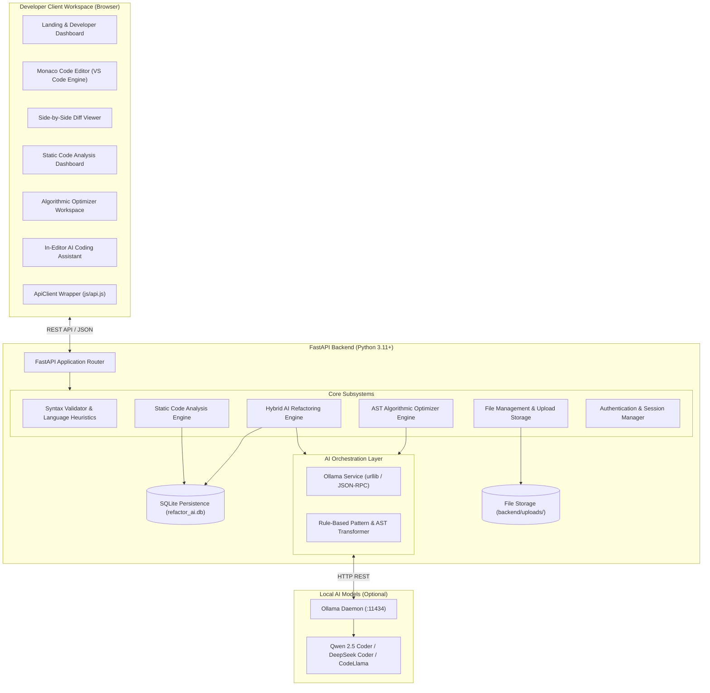

# System Architecture & Technical Design

This document details the software architecture, design principles, component interactions, and data flows of the **AI Code Refactoring Assistant**.

---

## 1. High-Level Architectural Overview

The application follows a **modular decoupled architecture**, combining a lightweight, high-performance **FastAPI (ASGI)** backend with a rich client-side developer workspace driven by the **Monaco Editor** and custom CSS design system.

---

## 2. Core Subsystems

### 2.1 Multi-Language Static Analysis Engine (`backend/analyzer/`)
- **Language Parsers**: Pluggable language-specific analyzers inheriting from `BaseAnalyzer`:
  - `PythonAnalyzer`: Combines Python's native `ast` module with regex security rules inspired by Bandit and OWASP (detects hardcoded credentials, unsafe `eval`/`exec`, `shell=True` subprocess calls, bare except clauses, poor variable naming, and long functions).
  - `JSAnalyzer`: Detects JavaScript/TypeScript code smells, `var` declarations, loose equality `==`, missing error handlers, and bracket inconsistencies.
  - `JavaAnalyzer`, `CPPAnalyzer`, `HTMLAnalyzer`, `CSSAnalyzer`: Specialized parsers enforcing standard naming conventions, modern syntax patterns, and accessibility guidelines.
- **Metrics Computation (`backend/metrics/`)**:
  - `complexity.py`: Computes Cyclomatic Complexity (McCabe metric), nesting depth, and function definitions.
  - `maintainability.py`: Computes Maintainability Index, Readability Score, Security Score, and an overall Health Score (0–100%) mapped to letter grades `A+` through `F`.
  - `duplication.py`: Sliding-window token detector identifying redundant line blocks.

---

### 2.2 Hybrid AI Refactoring Engine (`backend/services/ai/refactoring_engine.py`)
The engine operates on a **graceful degradation** model:
1. **Ollama LLM Execution**:
   - Queries `http://127.0.0.1:11434/api/tags` with a 0.5s connection probe.
   - If available, detects coder-specialized models (`qwen2.5-coder`, `deepseek-coder`, `codellama`, etc.).
   - Uses `PromptBuilder` to supply source code, detected static analysis issues, and selected refactoring mode (`Clean Code`, `Performance`, `Security Hardening`, `Modernize Syntax`, `Documentation / Typing`).
   - Parses structured JSON containing `refactored_code` and categorized `explanations`.
2. **Local Rule-Based Heuristic Fallback**:
   - If Ollama is unavailable or uninstalled, execution seamlessly falls back to a deterministic, local transformation pipeline (`_local_refactor_transform`).
   - Automatically modernizes deprecated patterns, wraps hardcoded credentials with `os.getenv()`, replaces bare excepts with explicit exceptions, and executes algorithmic optimizations without external API dependencies.

---

### 2.3 Algorithmic Code Optimizer (`backend/services/ai/optimizer_engine.py`)
- Analyzes algorithmic time complexity bottlenecks (e.g. converting nested list membership lookups `O(N^2)` into hash set lookups `O(N)`).
- Automatically injects caching primitives (`@lru_cache(maxsize=128)`).
- Simplifies nested conditional branches and flattens redundant loops.
- Separates frontend code (HTML/CSS/JS) and backend code (Python/Express/Java) when mixed snippets are provided.

---

### 2.4 Data Persistence & Storage
- **Relational Metadata (`refactor_ai.db`)**: SQLite database storing:
  - `analysis_reports`: Historical code analysis results, complexity metrics, detected issues, and health scores.
  - `refactoring_history`: Full records of refactoring sessions, including before/after metrics, diffs, and rationale.
- **File System Storage (`backend/uploads/`)**:
  - Uploaded developer scripts and project files indexed via `_metadata.json` with MIME types, byte counts, and timestamps.
